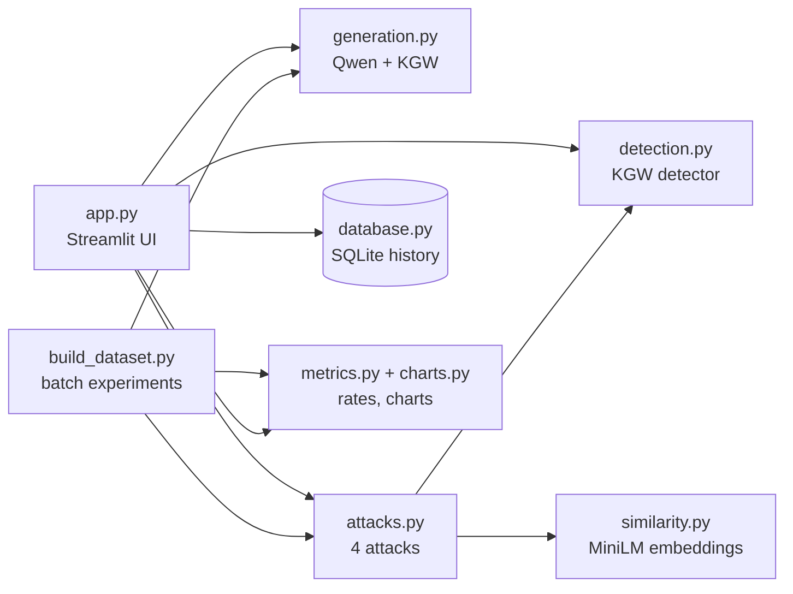

# WaterMarkX

A tool for generating and detecting KGW (Kirchenbauer et al.) text watermarks on LLM output, using Qwen2.5-1.5B-Instruct. Includes a Python/FastAPI backend and a React frontend with live generation progress.

---

## Project Structure

    WaterMarkX/
    ├── venv/                  # Python virtual environment (not committed)
    ├── frontend/               # React + Vite + Tailwind UI
    ├── main.py                # FastAPI backend (API used by the frontend)
    ├── kgw_detect.py           # Standalone CLI: generate + detect watermark
    ├── kgw_test.py             # Standalone CLI: generate only
    ├── qwen_test.py            # Standalone CLI: plain Qwen generation, no watermark
    ├── detection.py            # Shared KGW config, model loading, detect_text()
    ├── generation.py           # generate_text() (normal / watermarked)
    ├── attacks.py              # Phase 3 attacks + before/after evaluation
    ├── run_attack.py           # CLI: run one attack and re-detect
    ├── app.py                  # Streamlit app (main interface)
    ├── similarity.py           # meaning similarity (sentence embeddings)
    ├── metrics.py              # detection rates and attack summaries
    ├── charts.py               # comparison charts (PNG)
    ├── database.py             # SQLite history
    ├── build_dataset.py        # batch experiments: generate, attack, summary
    ├── docs/                   # demo script, viva notes, limitations
    ├── tests/                  # pytest tests
    ├── experiments/            # datasets, results, charts
    ├── requirements.txt        # Python dependencies
    └── README.md

---

## Backend Setup

### Step 1 — Create a Virtual Environment

On Windows:

```powershell
python -m venv venv
```

Activate it in PowerShell:

```powershell
.\venv\Scripts\Activate.ps1
```

Or in Command Prompt:

```text
venv\Scripts\activate
```

After activation, the terminal should show something similar to:

```text
(venv) C:\...\WaterMarkX>
```

### Step 2 — Install Dependencies

Run:

```powershell
pip install -r requirements.txt
```

The required libraries are:

```text
torch
transformers==5.15.1
accelerate
sentencepiece
fastapi
uvicorn[standard]
```

### Step 3 — Verify Installation

Check PyTorch:

```powershell
python -c "import torch; print('PyTorch:', torch.__version__)"
```

Check Transformers:

```powershell
python -c "import transformers; print('Transformers:', transformers.__version__)"
```

Check KGW support:

```powershell
python -c "from transformers import WatermarkingConfig, WatermarkDetector; print('KGW support: OK')"
```

The project currently uses:

```text
Transformers 5.15.1
```

### Step 4 — Running the API Server

Make sure the virtual environment is activated.

Run:

```powershell
uvicorn main:app --reload --port 8000
```

On the first run, Hugging Face will automatically download:

```text
Qwen/Qwen2.5-1.5B-Instruct
```

Therefore, an internet connection is required during the first run. The model does not need to be manually downloaded or placed inside the project folder. After downloading, Transformers can reuse the locally cached model.

Once you see:

```text
Model ready on device: ...
Application startup complete.
```

the backend is live at `http://127.0.0.1:8000`. You can test it directly at `http://127.0.0.1:8000/docs`.

### Available Endpoints

| Endpoint           | Method | Purpose                                                  |
|--------------------|--------|-----------------------------------------------------------|
| `/health`          | GET    | Confirms server + model are up                             |
| `/generate`        | POST   | Generates baseline + watermarked text (single response)    |
| `/generate-stream` | POST   | Same as above, but streams live progress + partial text    |
| `/detect`          | POST   | Runs KGW detection on given text, returns z-score etc.      |

---

## Frontend Setup

The frontend lives in `frontend/` — a React app built with Vite and Tailwind CSS.

### Step 1 — Install Dependencies

```powershell
cd frontend
npm install
```

### Step 2 — Run the Dev Server

```powershell
npm run dev
```

Opens at `http://localhost:5173`.

> The frontend calls the backend at `http://127.0.0.1:8000` — make sure the backend is running first.

---

## Running the Full App

Two terminals, both open at once:

**Terminal 1 — backend**

```powershell
cd WaterMarkX
.\venv\Scripts\Activate.ps1
uvicorn main:app --reload --port 8000
```

**Terminal 2 — frontend**

```powershell
cd WaterMarkX\frontend
npm run dev
```

Then open `http://localhost:5173` in your browser.

---

## Standalone CLI Scripts (No Server Needed)

These run independently of the frontend/backend, directly from the terminal — useful for quick testing.

```powershell
python kgw_detect.py
```

The program will ask:

```text
Enter your prompt:
```

Example:

```text
Explain artificial intelligence in simple words.
```

### What the Program Does

The program performs the following steps:

1. Load Qwen
2. Take user prompt
3. Generate normal/original text
4. Configure KGW
5. Generate watermarked text
6. Tokenize both texts
7. Create KGW detector
8. Detect watermark in original text
9. Detect watermark in watermarked text
10. Calculate detection statistics
11. Display results

`kgw_test.py` and `qwen_test.py` are simpler variants (generation only, no CLI input / no watermarking respectively) used during early development.

---

## Streamlit App (main interface)

```powershell
.\venv\Scripts\Activate.ps1
streamlit run app.py
```

Opens at `http://localhost:8501`. The model loads the first time you press
Generate, Verify or Run attack (about 30 s), then stays loaded.

| Page | What you can do |
|---|---|
| **Generate** | Enter a prompt and generate normal and/or watermarked text, with detection results |
| **Verify** | Paste any text and check it for the watermark, with an explanation of what the result means |
| **Robustness** | Pick an attack, apply it, and compare before/after z-scores and meaning similarity |
| **Analytics** | Dataset results: detection rates, attack summaries and charts |
| **History** | Everything saved in SQLite (`experiments\watermarkx.db`), downloadable as CSV |

## Architecture



All parts share one loaded model and one KGW configuration
(`greenlist_ratio=0.5`, `bias=2.0`, `seeding_scheme="lefthash"`, threshold `z ≥ 3.0`),
defined once in `detection.py`.

> The React frontend + FastAPI backend (`frontend/`, `main.py`) from earlier work
> still works as before and is unchanged.

---

## Phase 3 — Robustness Attacks

Attacks change the text itself (without knowing the watermark key). The original and
attacked texts are then checked by the **same** KGW detector with the **same**
settings and threshold (z ≥ 3.0).

| File | Purpose |
|---|---|
| `detection.py` | KGW settings, loads Qwen + detector once, `detect_text()` |
| `generation.py` | `generate_text()` — normal or watermarked |
| `attacks.py` | The attacks, `evaluate_attack()` (before/after detection) and CSV export |
| `run_attack.py` | Command-line runner |
| `tests/` | Unit tests (fake models) + one real-model test |

| Attack | What it does | Extra download |
|---|---|---|
| `paraphrase` | Qwen rewrites the text (watermarking **off**) | none |
| `synonym` | Replaces a share of eligible words with WordNet synonyms (skips names, numbers, stopwords) | WordNet (~15 MB) |
| `translation` | English → German/French/Spanish → English with MarianMT | ~300 MB per model, 2 models |
| `combined` | Paraphrase, then synonym replacement | WordNet |

### One-time setup (after `pip install -r requirements.txt`)

```powershell
python -m nltk.downloader -d venv\nltk_data wordnet averaged_perceptron_tagger_eng
```

**GPU (optional):** a plain `pip install` gives a CPU-only PyTorch on Windows. For an NVIDIA GPU:

```powershell
pip install --force-reinstall --no-deps torch==2.14.1 --index-url https://download.pytorch.org/whl/cu126
python -c "import torch; print(torch.cuda.is_available())"
```

### Run an attack

```powershell
python run_attack.py --prompt "Explain how vaccines work in simple words." --attack paraphrase --seed 42
python run_attack.py --text-file experiments\sample_wm.txt --attack synonym --proportion 0.3 --seed 42
python run_attack.py --text-file experiments\sample_wm.txt --attack translation --pivot de
python run_attack.py --text-file experiments\sample_wm.txt --attack combined --proportion 0.3 --seed 42
```

Each run prints before/after z-scores and appends a row to `experiments\attack_results.csv`.

The `outcome` column is decided **only from detector results**:

- `watermark_removed` — detected before, not detected after
- `watermark_survived` — detected before and after
- `not_comparable` — the original was not detected, so there is nothing to remove
- `attack_failed` / `detection_failed` — something went wrong (see the `error` column)

### Charts

```powershell
python charts.py
```

Reads `experiments\attack_results.csv` and writes to `experiments\charts\`:

- `z_score_before_after.png`: mean z-score before vs after each attack, with the 3.0 threshold
- `green_fraction_before_after.png`: green-token share before vs after (0.5 = unwatermarked)
- `detection_rate_after.png`: share of samples still detected after each attack
- `attack_summary.csv`: the numbers behind the charts

Only samples whose original text was detected are plotted. Each chart shows the
sample size `n`, so small-sample results aren't mistaken for reliable rates.

### Experiment dataset (many samples)

```powershell
python build_dataset.py generate    # 20 prompts -> normal + watermarked text, detected
python build_dataset.py attack      # all 4 attacks on every watermarked text
python build_dataset.py summary     # tables + charts in experiments\charts\dataset\
```

- Normal and watermarked text for a prompt use the **same seed**, so the watermark is the only difference.
- Both steps are **resumable**: stop with Ctrl+C and run the same command again to continue. Failed rows are saved with their error and retried next time.
- `--limit 2` runs a quick trial; `--prompts-file my_prompts.txt` uses your own prompts.
- The summary reports the **true positive rate** (watermarked text detected) and the **false positive rate** (normal text wrongly flagged).

Outputs: `experiments\dataset.csv`, `experiments\dataset_attack_results.csv`, `experiments\dataset_run_info.json`.

### Tests

```powershell
python -m pytest -v                                     # fast, no model download
$env:RUN_INTEGRATION = "1"; python -m pytest tests\test_integration_paraphrase.py -v -s   # real Qwen
```

---

## Notes

- Running on CPU is slow (30–90s per generation). A CUDA-capable GPU will speed this up significantly if available — the backend auto-detects `torch.cuda.is_available()`.
- The KGW watermark uses `greenlist_ratio=0.5`, `bias=2.0`, `seeding_scheme="lefthash"`, `z_threshold=3.0` — see `main.py` to adjust.